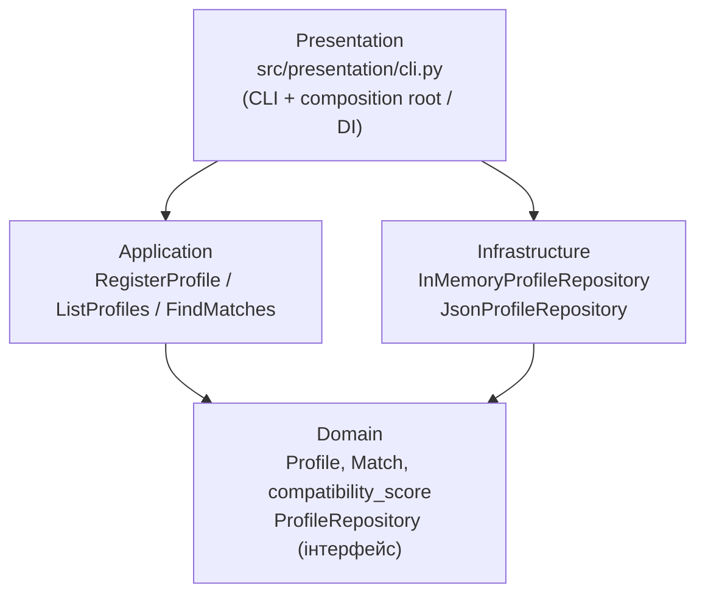

# Roommate Finder

Консольний застосунок для пошуку та підбору сусідів для спільної оренди житла.
Лабораторна робота №5 («Сучасні технології проєктування»): Clean Architecture + Git.

## Архітектура



Усі стрілки напрямлені всередину, до Domain. Domain нічого не знає про інші шари.
Інтерфейс `ProfileRepository` оголошено в Domain, реалізації лежать в Infrastructure,
Application працює лише з абстракцією (принцип інверсії залежностей).

## Структура

```
src/
  domain/          entities.py, errors.py, repositories.py, scoring.py
  application/     use_cases.py
  infrastructure/  memory_repository.py, json_repository.py
  presentation/    cli.py
tests/             unit-тести шарів
config.json        вибір сховища (memory | json)
```

## Збірка і запуск

Потрібен Python 3.9+ (зовнішніх залежностей немає).

```bash
git clone <URL-репозиторію> && cd roommate-finder
python -m unittest discover -s tests -t .      # тести

python -m src.presentation.cli register --name Аня --city Київ --budget 8000 --sleep early --cleanliness 4
python -m src.presentation.cli register --name Олег --city Київ --budget 8200 --sleep early --cleanliness 4
python -m src.presentation.cli list
python -m src.presentation.cli match --id <ID_анкети>
```

Щоб змінити сховище, достатньо поправити `"storage"` у `config.json` (`json` або `memory`).

## Гілкування

`main` — стабільний код, `develop` — інтеграційна гілка, `feature/*` — гілки під задачі.
Коміти за Conventional Commits.
